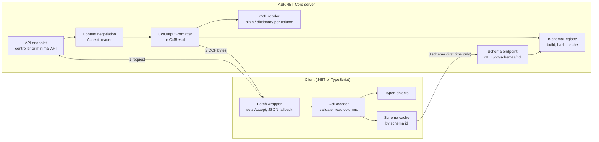
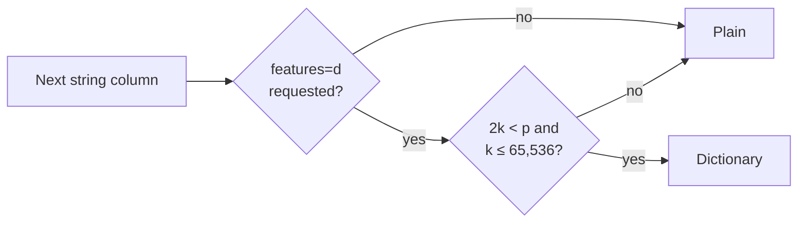

# CCF Architecture

How the libraries are structured and how they behave around the wire format. The wire format itself is defined only in `SPEC.md`; where the two seem to disagree, `SPEC.md` wins.

## 1. Goals

1. **Smaller payloads** than JSON without needing HTTP compression.
2. **Faster parsing** than JSON: no scanning, no unescaping, no text-to-number conversion, no decompression.
3. **Zero disruption**: JSON stays the default; endpoints need no code changes; any problem falls back to JSON.

Scope of this build: .NET server, .NET client, JavaScript/TypeScript client. Mobile (Swift, Kotlin) is a future phase.

## 2. Components



### Packages

| Package | Contents | Depends on |
| --- | --- | --- |
| `Ccf.Core` (.NET) | Schema model, canonicalizer, hasher, schema builder, encoder, decoder, limits, errors | Nothing outside the BCL |
| `Ccf.AspNetCore` (.NET) | `AddCcf`, output formatter, `CcfResults`, schema endpoint, options | `Ccf.Core`, ASP.NET Core |
| `Ccf.Client` (.NET) | `HttpClient` extensions, schema cache, JSON fallback | `Ccf.Core`, `System.Net.Http.Json`, `Microsoft.Extensions.Logging.Abstractions` |
| `@ccf/client` (npm) | Decoder, schema cache, `fetch` wrapper, TS type generator CLI | None at runtime |

## 3. Server: ASP.NET Core integration

### 3.1 Registration

```csharp
builder.Services.AddCcf(o =>
{
    o.DictionaryThreshold = 0.5;          // §8.1 of SPEC; 0.5 is the conformance default
    o.Limits.MaxRows = 100_000;
    o.SchemaPathPrefix = "/ccf/schemas";
});
// …
app.MapCcfSchemas();                        // GET /ccf/schemas/{id}
```

`AddCcf` registers:

| Service | Lifetime | Role |
| --- | --- | --- |
| `IOptions<CcfOptions>` | singleton | Threshold, limits, path prefix, dev query override; bindable from `appsettings.json` section `Ccf`, validated on start |
| `ISchemaRegistry` | singleton | `(Type, naming policy) → CcfSchema` cache and `id → CcfSchema` index, thread-safe (`ConcurrentDictionary`) |
| `CcfEncoder` | singleton | The encoder of the MVC path; stateless, thread-safe (an internal twin serves the minimal-API path, see 3.3) |
| `CcfOutputFormatter` | added to `MvcOptions.OutputFormatters` | MVC controllers get CCF through normal negotiation |
| `OutputFormatterSelector` | singleton, replaced | Decorates MVC's `DefaultOutputFormatterSelector` (see 3.2) |
| `IStartupFilter` | transient | Development query override, `Vary: Accept` middleware, startup naming warning |

It is not a hosted/background service: nothing runs unless a request asks for CCF.

**Naming follows the path's own JSON options.** MVC responses use MVC's `JsonOptions.JsonSerializerOptions.PropertyNamingPolicy`; minimal APIs use `Microsoft.AspNetCore.Http.Json.JsonOptions` (`ConfigureHttpJsonOptions`). The registry is keyed by (type, naming policy), so differing policies produce different schemas and ids, each served by the schema endpoint. One warning is logged at startup if the two policies differ.

### 3.2 Content negotiation and the output formatter

**Rule (`CcfNegotiation.TryNegotiate`).** CCF is served only when `application/vnd.ccf` is listed *explicitly* with `q > 0` and no other explicit media type the server can produce (`application/json`, `text/json`, `*+json`) has a higher `q`. Wildcards (`*/*`, `application/*`) never compete, so `application/vnd.ccf, */*;q=0.1` yields CCF. Equal `q` keeps header order, so `application/json, application/vnd.ccf` yields JSON. `q=0` means not acceptable. `features` is read from the winning range, quoted or bare; unknown letters are ignored. `MvcOptions.RespectBrowserAcceptHeader` is left alone.

**MVC.** MVC ignores an `Accept` header containing `*/*`, so CCF wraps the selector: `CcfOutputFormatterSelector` applies the rule above first (honouring `[Produces]`/`ObjectResult.ContentTypes`, and falling back to `MvcOptions.OutputFormatters` when the result carries no formatters of its own) and otherwise delegates to MVC unchanged. `CcfOutputFormatter : OutputFormatter` (supported media type `application/vnd.ccf`):

1. `CanWriteResult`: true only when the offered media type is `application/vnd.ccf`, the rule above agrees, the value is not null and `ISchemaRegistry.TryGetSchema(objectType)` succeeds. It never claims a response without an explicit offer, so wildcard or absent `Accept` stays JSON, and it is registered after the built-in formatters.
2. Materialize a lazy `IEnumerable<T>` response **once** into a list (arrays and `IList` are used as they are), so an LINQ or EF query is never executed twice.
3. Encode the whole payload into a pooled buffer.
4. On `CcfEncodeException`: log a warning with the schema id and reason, then write the *materialized* value as JSON through the first registered JSON `TextOutputFormatter` (headers have not been sent yet).
5. On success: set `Content-Type` per SPEC §2.3 from the flags actually produced, set `Content-Length`, copy the buffer to the body.

**Why `CanWriteResult` is custom** (verified in `CcfMediaTypeMatchingTests`): MVC passes the Accept range, parameters included, as `context.ContentType`, but the stock `OutputFormatter.CanWriteResult` only matches when the formatter's media type carries every parameter of that range, so `application/vnd.ccf` never matches `application/vnd.ccf; features=d`. The formatter compares type/subtype only and reads `features` from the request.

**`Vary: Accept`.** Sent (a) on every response to a request whose `Accept` mentions `application/vnd.ccf`, whatever the outcome (CCF, JSON, fallback, 204, 404, unsupported type, scalar), by an early middleware that adds it when the response starts; and (b) on JSON responses of endpoints whose value type has a CCF schema even if the request did not mention CCF (SPEC §2.3), by a result filter (MVC) and inside `CcfResults.Ok`. It is never duplicated.

**Development override.** `?ccf=d` (or `?ccf=` for plain CCF) rewrites `Accept` as if the request had sent `application/vnd.ccf; features=…`; `?ccf=off|json|0` leaves it alone. Active only when `AllowQueryOverride` is set and the environment is Development.

### 3.3 Minimal APIs

`CcfResults.Ok<T>(T value)` returns an `IResult` that applies the same rule (CCF if accepted and supported, otherwise `TypedResults.Ok(value)` as JSON), materializes a lazy sequence once, falls back to JSON from the same list on an encode failure, and uses the Http `JsonOptions` naming. A `.WithCcf()` endpoint filter that wraps existing handlers is a possible later, optional addition; it is not implemented.

### 3.4 Schema endpoint

`MapCcfSchemas()` maps `GET {prefix}/{id:regex(^[0-9a-f]{{8}}$)}` to the registry. Returns the canonical JSON with the immutable cache header (SPEC §2.4), 404 for unknown ids. Schemas are registered lazily the first time a type is encoded; `ISchemaRegistry.Register<T>()` lets apps pre-register types at startup so the endpoint knows them before the first request (important when several server instances run behind a load balancer).

### 3.5 Observability

- `ILogger` category `Ccf`: debug on schema registration, warning on fallback after an encode failure.
- `System.Diagnostics.Metrics` meter `Ccf`: counters `ccf.responses` (tag `format` = ccf/json-fallback, `features`), `ccf.bytes_written`, `ccf.encode_failures`.

## 4. Encoder design

- One pass per column over the row list, writing into the buffer; the column's block length is known only afterwards, so each block is written into a scratch region and its length prefix is written before copying, or space is reserved and the body shifted. Pick whichever profiles faster; both must produce the shortest uvarint.
- Property values are read through compiled accessors (expression trees or a source generator), cached per type in the registry — no reflection per value.
- API shape: `new CcfEncoder(CcfSchemaOptions? options, double dictionaryThreshold = 0.5)` (the options carry the naming rules used to build the schema) and `Encode(object value, CcfSchema schema, CcfFeatures features, IBufferWriter<byte> output, CcfLimits? limits)`, which returns the header flags actually produced (the Content-Type derives from them via `CcfFeatureParser.ContentTypeFor`). The payload is built completely in a pooled buffer and only then copied to `output`.
- Internally each column is first extracted into a row-aligned `ColumnData` (typed arrays plus a presence array) and then written by a CLR-independent writer; the decoder produces the same `ColumnData`, which the untyped value tree and the typed binder both read. Accessors are compiled once per (canonical schema text, CLR type).
- Dictionary decision per string column: collect distinct values with a `Dictionary<string,int>` (ordinal comparer), which also yields first-appearance order.
- Allocation goal: zero allocations per value; pooled buffers; `Span<byte>`/`stackalloc` for varints.

## 5. Schema building from .NET types

The schema mirrors what System.Text.Json would emit, so CCF and JSON field names always match.

### 5.1 Type mapping

| .NET type | CCF type |
| --- | --- |
| `bool` | `bool` |
| `sbyte`, `short`, `int` | `int32` |
| `byte`, `ushort`, `uint` | `uint32` |
| `long` | `int64` |
| `ulong` | `uint64` |
| `float`, `double` | `float64` |
| `decimal` | `decimal` (scale from `[CcfDecimal]`, else `CcfOptions.DefaultDecimalScale`, default 2) |
| `string` | `string` |
| `enum` (non-`[Flags]`) | `enum`, `values` = member names in declaration order (respecting `[JsonStringEnumMemberName]` if present) |
| `DateTime`, `DateTimeOffset` | `datetime` (`DateTime` Unspecified is treated as UTC) |
| `Guid` | `guid` |
| `Nullable<T>` | the type of `T`, `nullable: true` |
| class / record / struct with public properties | `object` |
| `T[]`, `List<T>`, `IList<T>`, `IReadOnlyList<T>`, `IEnumerable<T>`, `ICollection<T>` | `list` (scalar `T` → `$value` field) |

Root: a collection of `T` → table of `T`; a single `T` → table of 1 row with flag `S`.

### 5.2 Names, order, attributes

- Field names: the JSON name — `[JsonPropertyName]`, else the MVC `JsonSerializerOptions.PropertyNamingPolicy` (camelCase by default).
- Order: System.Text.Json order, honoring `[JsonPropertyOrder]`.
- `[JsonIgnore]` (unconditional) excludes a property. Conditional ignore (`WhenWritingNull` etc.) does not change the schema; the field is simply nullable.
- `[CcfDelta]` sets `delta: true`. `[CcfDecimal(scale, Unsigned = true)]` sets scale/unsigned.
- Nullability of reference types from nullable reference type annotations (`NullabilityInfoContext`); un-annotated reference types are nullable.

### 5.3 Unsupported → JSON fallback

If any reachable member is unsupported, the whole response type is unsupported and its responses are served as JSON (logged once at debug level): `object`, `dynamic`, `JsonElement`/`JsonNode`, dictionaries, interfaces and abstract classes (other than the collection interfaces above), polymorphic hierarchies (`[JsonDerivedType]`), `[Flags]` enums, `char`, `byte[]`, `TimeSpan`, `DateOnly`, `TimeOnly`, `Half`, `Int128`, `BigInteger`, recursive types, depth > 8, names not matching the identifier pattern, custom `JsonConverter`s on a member.

## 6. Clients

### 6.1 Shared behaviour (.NET and TypeScript)

1. Send `Accept: application/vnd.ccf; features=d, application/json;q=0.5` (plain `application/vnd.ccf, application/json;q=0.5` when the client cannot read dictionaries).
2. If the response `Content-Type` is not CCF → parse as JSON (fallback is normal, not an error). An empty body or `204` is a `null` result.
3. If CCF → read the schema id from bytes 4–7; get the schema from the cache, or fetch `GET {prefix}/{id}` once (concurrent requests for the same id share one fetch), verify that the returned text hashes to the id **and** is in canonical form, cache it. The schema URL is built from the origin of the request; a schema that ends up on another origin (redirect) is refused (SPEC §2.4). A cache read is verified again, so a corrupted persistent cache is ignored and refetched.
4. Decode. On a CCF format error or a failed schema fetch (HTTP error, network error, unknown id, hash mismatch, invalid schema) → log it and **repeat the original request once with `Accept: application/json`**. Only requests that are safe to repeat (GET, HEAD, or explicitly marked idempotent; never a streamed body) are retried; otherwise the error surfaces. A failed fetch is not remembered: the next request tries again. Errors that are not CCF failures are never retried: an HTTP error status, a usage error such as a target type that cannot receive the schema (.NET `InvalidOperationException`), or the `RangeError` of `int64: "number"`.
5. Schema cache: in memory by default; pluggable for persistent storage (IndexedDB in browsers, disk on .NET). Entries never expire (the id is a content hash). A failing cache never fails a request.

### 6.2 .NET client (`Ccf.Client`)

- `CcfClient(HttpClient, CcfClientOptions?)` holds the schema cache and the single-flight map; `client.GetAsync<T>(uri, ct)` and `client.SendAsync<T>(HttpRequestMessage, ct)` (retry only for GET/HEAD or when `CcfClientOptions.IsIdempotent` says so; the request is captured first so it can be sent again).
- `HttpClient.GetFromCcfAsync<T>(string uri, CancellationToken)` mirrors `GetFromJsonAsync<T>` and uses one default `CcfClient` per `HttpClient`; create a `CcfClient` for custom options.
- `CcfClientOptions`: `Features`, `SchemaPathPrefix`, `SchemaCache` (`ICcfSchemaCache`, async `GetAsync`/`SetAsync`, default `InMemoryCcfSchemaCache`), `JsonSerializerOptions` (JSON path and the naming policy used to match properties; default web defaults), `Limits`, `IsIdempotent`. Logging goes through an optional `ILogger<CcfClient>` constructor argument (DI when registered, `NullLogger` otherwise).
- Failures to obtain a schema are `CcfSchemaFetchException` (client-side, not a format error); an error status is `HttpRequestException`.
- Decodes into `T` by matching schema field names to properties with the same naming rules as the server (§5.2). Schema fields with no matching property are skipped (block length); properties with no matching field keep their default. Matching is by exact JSON name first, then case-insensitively. Narrowing into a smaller CLR type is range-checked (`ValueOutOfRange`). A CLR type that cannot receive the schema (incompatible property type, abstract type, several rows into a single object) raises `InvalidOperationException`: a usage error, not a format error. Datetimes outside the .NET `DateTime` range (years 1–9999) are rejected by the .NET decoder with `ValueOutOfRange`.
- Decimals decode exactly to `decimal`; datetimes to `DateTimeOffset` (offset 0) or `DateTime` (Kind Utc).

### 6.3 TypeScript client (`@ccf/client`)

- Runs in browsers and Node 20+; ES modules; zero runtime dependencies; uses `DataView`, `TextDecoder("utf-8", { fatal: true, ignoreBOM: true })` (the BOM is data, not a marker).
- `createCcfClient({ baseUrl?, fetch?, schemaCache?, features?, schemaPathPrefix?, int64?, decimal?, limits?, isIdempotent?, log? })` → `client.get<T>(path, init?)`, `client.request<T>(path, { method, body, idempotent, … })`, `client.getSchema(id, origin)`. Lower level: `decode(bytes, schema, options)` (synchronous), `readSchemaId(bytes)`, `parseSchema(text)` (**async**: it hashes with WebCrypto, falling back to a built-in pure-JS SHA-256 where `crypto.subtle` is unavailable, such as insecure browser origins), `verifySchema(id, text)`.
- Schema caches implement `CcfSchemaCache { get(id), set(id, canonicalJson) }` (sync or async, storing the canonical text, which is re-verified when read): `MemorySchemaCache` (default) and `IndexedDbSchemaCache`.
- Errors: `CcfFormatError` (same code strings as .NET), `CcfSchemaError` (invalid schema, SPEC §14.3), `CcfSchemaFetchError`, `CcfHttpError`.
- Value mapping: int64/uint64 → `number` by default, throwing a `RangeError` if a value is beyond `Number.MAX_SAFE_INTEGER`; option `int64: "bigint"`. Decimal → `number` by default (may round for values beyond 2^53 or many digits); option `decimal: "string"` for exact values with `scale` digits. Datetime → `Date` (values outside the range of `Date`, ±8.64e15 ms, are `ValueOutOfRange`). Guid → lowercase string. Enum → member name string. `null` for absent values. A single-object payload decodes to an object, a table to an array of objects.
- `ccf-typegen <schema file | - | URL> [-o out.ts] [--name Root] [--int64 number|bigint] [--decimal number|string]` reads a schema (a URL ending in an id is verified against it) and writes TypeScript interfaces: the root interface is named after the schema, nested objects become `<Parent><Field>` and object list elements `<Parent><Field>Item`; `--int64`/`--decimal` should match the client options.

## 7. Flows

### 7.1 First request for a schema

```mermaid
sequenceDiagram
  participant App as Application
  participant C as CCF client
  participant S as ASP.NET server
  participant E as Schema endpoint
  App->>C: load products
  C->>S: GET /products<br/>Accept: application/vnd.ccf; features=d, application/json;q=0.5
  Note over S: schema c33a3ed0 from registry<br/>encode: name column uses dictionary
  S-->>C: 200, Content-Type: application/vnd.ccf; features=d (5,266 bytes)
  Note over C: read header: schema c33a3ed0 not cached
  C->>E: GET /ccf/schemas/c33a3ed0 (first time only)
  E-->>C: canonical schema JSON, immutable
  Note over C: verify hash, cache, validate and decode 5 columns
  C-->>App: 500 typed objects
```

Every later request with the same schema skips the schema call.

### 7.2 Encoding choice per string column



### 7.3 Fallback paths (all end in JSON)

| Situation | Who falls back | How |
| --- | --- | --- |
| Client did not accept CCF | Server | JSON formatter selected by MVC |
| Response type unsupported, value null or scalar | Server | Formatter `CanWriteResult` returns false |
| Encode failure (bad decimal, null in non-nullable, limit) | Server | Formatter writes JSON from the same buffer-before-send design |
| Schema fetch fails or hash mismatch | Client | Repeat the request with `Accept: application/json` |
| Decoder throws a CCF format error | Client | Same retry |

## 8. Security

Summarised from SPEC §9 and §11: every length, count and index is checked against limits and remaining bytes before use; decoders never allocate from an unchecked count; strings are validated UTF-8; schemas come only from the API's own origin and their hash is verified; the encoder enforces the same limits so a server never emits what its clients would reject. Phase 1 includes a fuzz test of the decoder.

## 9. Measured metrics

Sample: 500 products (id, name, price, status, stock), 142 distinct names, final wire layout (10-byte header, mode byte and block length per column). Same data as `test-vectors/v01` and `v02`.

| Format | Raw | Gzip -9 | Brotli q11 | Raw vs JSON |
| --- | --- | --- | --- | --- |
| JSON, minified | 39,660 | 6,250 | 5,258 | 1× |
| TOON, tabular | 19,182 | 5,836 | 4,894 | 2.1× smaller |
| CCF plain (`v01`) | 9,317 | 4,229 | 3,625 | 4.3× smaller |
| CCF dictionary (`v02`) | **5,266** | 3,749 | 3,187 | 7.5× smaller |

Uncompressed dictionary-mode CCF is 16% smaller than Gzip JSON and within 8 bytes of Brotli JSON at maximum quality, with no decompression step. Where the dictionary-mode bytes go: name 2,323 (44%), price 1,423, stock 932, id 501, status 63, plus header and block prefixes.

**Parse speed has not been measured yet**; it is the go/no-go gate in PLAN.md phase 4.

## 10. Future

- **Mobile clients**: Swift (iOS) and Kotlin (Android) decoders, validated against the same `test-vectors/`. Planned after phase 5.
- **Feature `n`** (numeric encoding: frame-of-reference / bit-packing for integer and decimal columns). Price is the next-largest column.
- **Request bodies**: an input formatter so clients can POST CCF. Not in this build.
